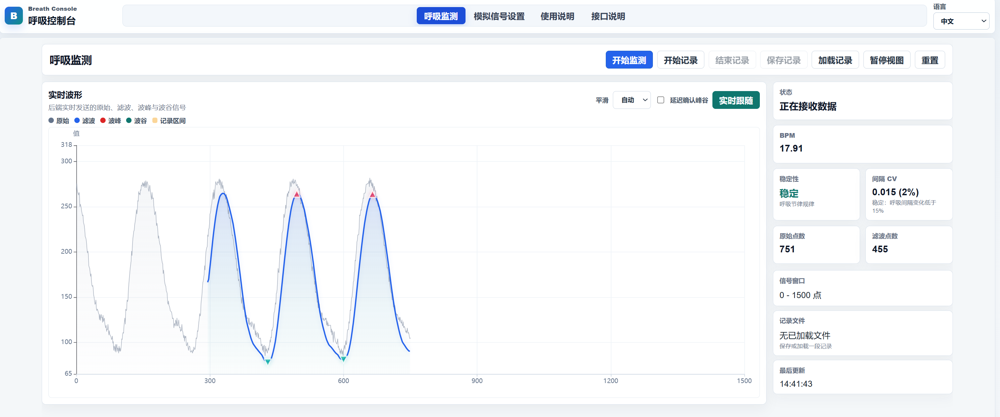
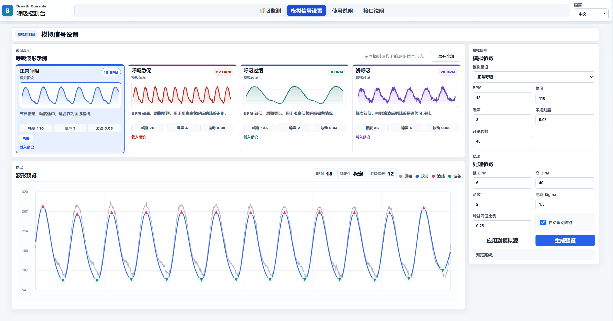
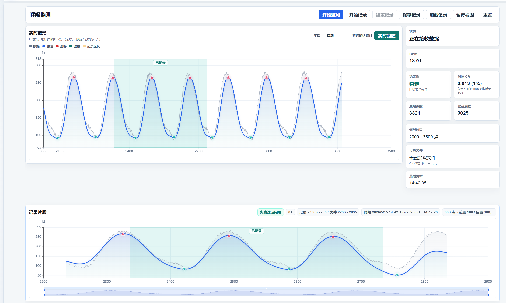
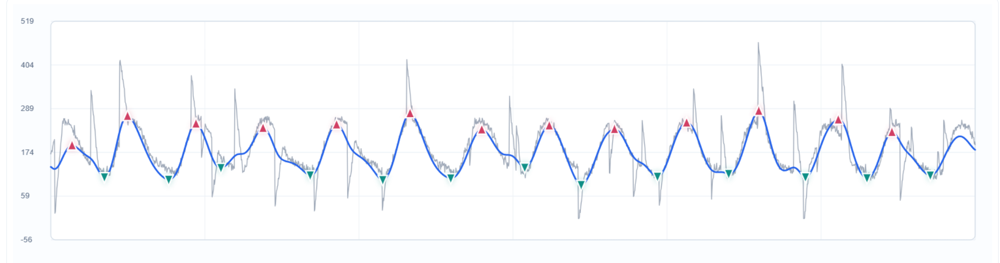
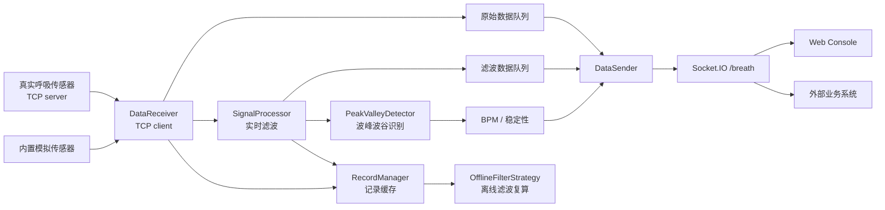

# RespiraScope

RespiraScope 是一个呼吸信号采集、滤波、实时展示和记录分析工具。它支持真实 TCP 呼吸传感器，也内置了模拟呼吸信号，适合用于设备联调、算法验证、呼吸波形处理学习和前端可视化演示。

> 本项目用于工程验证、算法学习和设备调试，不作为医疗诊断、治疗决策或临床监护依据。

## 功能特性

- TCP 呼吸传感器数据接入。
- 内置模拟呼吸信号，支持多种呼吸状态场景。
- 实时滤波、离线滤波复算和自适应滤波参数。
- 波峰、波谷识别，以及 BPM 和呼吸稳定性计算。
- Socket.IO 实时推送原始数据、滤波数据、峰谷事件和指标。
- Web Console 单页入口，面向公网体验提供实时体验和模拟实验两种模式。
- Record Start / End 记录区间，支持 start 前和 end 后辅助数据。
- uv 管理依赖和启动流程，支持 Windows exe 打包。

## 界面预览

### 呼吸监测

Breath Monitor 面向实际使用者，展示后端实时推送的原始呼吸波形、滤波波形、波峰波谷、BPM 和呼吸稳定性。



### 模拟信号设置

模拟信号设置页用于后端调试和滤波观察，可以切换多种模拟呼吸状态，调整模拟参数和处理参数，并预览原始波形、滤波结果、波峰和波谷。



### 记录分析

记录片段用于查看 Record Start 到 Record End 期间的原始数据、滤波数据、波峰波谷，并支持带前后辅助点的记录文件。



### 异常信号处理

异常信号处理用于观察咳嗽、突发干扰和不规则呼吸片段对实时波形、滤波结果、波峰波谷识别和 BPM 指标的影响，便于调试算法鲁棒性。


咳嗽伪影场景展示了短时强扰动下的波形变化和滤波表现，可用于验证异常片段识别、回看和记录复盘效果。



## 软件结构

RespiraScope 由后端采集处理服务、统一 Web Console、模拟传感器和外部配置文件组成。



核心模块：

| 层级 | 说明 |
| --- | --- |
| 传感器输入 | 后端作为 TCP client 连接真实呼吸设备；也可以启用内置模拟传感器 |
| 实时处理 | `DataReceiver` 接收原始点，`SignalProcessor` 实时滤波，`PeakValleyDetector` 识别峰谷并计算 BPM |
| 数据推送 | 后端通过 Socket.IO `/breath` 命名空间广播 raw、filtered、peak、valley、metrics |
| 记录复算 | Record 结束后可使用离线滤波重新处理记录区间，获得更平滑的复盘结果 |
| Web Console | 原生 HTML/CSS/JavaScript 组织实时体验和模拟实验，随 Python 服务一起启动，无需前端构建 |
| 外部配置 | 不依赖 `.env`，从 Windows、macOS 或 Linux 的外部配置路径读取部署配置 |

## 文件结构

```text
.
|-- config/                  # 示例配置
|-- docs/                    # 算法、接口、架构和开源说明
|-- scripts/                 # 开发和打包脚本
|-- src/
|   `-- ct_breath/           # Python 应用包
|       |-- app.py           # FastAPI / Socket.IO 应用创建
|       |-- asgi.py          # ASGI 部署入口
|       |-- config.py        # 外部配置读取
|       |-- main.py          # uv 统一启动入口
|       |-- web/             # 随 Python 包分发的完整 UI 静态源码
|       |   |-- frontend-console/  # 统一入口，无需 Node/npm
|       |   |-- frontend-monitor/  # 实时监测与记录分析
|       |   |-- frontend-lab/      # 模拟实验
|       |   |-- frontend-guide/    # 使用说明
|       |   `-- frontend-api-docs/ # 接口说明
|       |-- breath_process/  # 采集、滤波、峰谷识别、记录
|       |-- http/            # HTTP API 和 Pydantic schema
|       `-- mock_sensor/     # 模拟传感器
`-- tests/                   # 单元测试
```

`src/` 只是源码根目录。业务代码应通过 `ct_breath` 导入，例如：

```python
from ct_breath.app import create_socket_app
```

不要写成 `src.ct_breath`。

## 快速开始

只需安装 uv；Python 和依赖由 uv 管理。运行和修改 UI 均无需 Node.js、npm 或前端构建。

安装依赖（可选，`uv run` 会自动同步）：

```bash
uv sync
```

启动后端和 Web Console：

```bash
uv run respirascope
```

控制台会打印实际的 Backend API、Open Console、Monitor 和 Mock Lab 地址。旧命令 `uv run RespiraScope` 仍然兼容。

默认访问地址：

- Backend: `http://localhost:8000`
- Web Console: `http://localhost:5175`
- 实时体验: `http://localhost:5175/#monitor`
- 模拟实验: `http://localhost:5175/#lab`

第一次启动时，如果外部配置文件不存在，程序会自动生成一份默认配置。

如果配置中的 backend port 已经被占用，启动脚本会自动寻找下一个可用端口，并把这个实际端口写入前端运行时配置。请以控制台打印的 Backend 和 Web Console 地址为准。

## 基础使用说明

### 1. 选择数据来源

开发和调试时可以启用模拟信号：

```toml
[mock]
enabled = true
```

连接真实呼吸传感器时关闭模拟信号，并配置设备地址：

```toml
[mock]
enabled = false

[sensor]
host = "设备 IP"
port = 8088  # 替换为设备端口
```

### 2. 启动系统

```bash
uv run respirascope
```

启动后打开控制台：

```text
http://localhost:5175
```

也可以直接进入指定模式：

```text
http://localhost:5175/#monitor
http://localhost:5175/#lab
```

### 3. 调试模拟信号

启用模拟信号后，进入 `模拟信号设置`：

1. 选择一种预设呼吸波形，例如正常呼吸、呼吸急促、浅呼吸、屏气、体动伪影等。
2. 调整 BPM、幅度、噪声和不规则度。
3. 点击 `应用到模拟源`，让后端模拟传感器使用当前配置。
4. 点击 `生成预览`，查看原始波形、滤波结果、波峰波谷和指标。

### 4. 实时监测

进入 `呼吸监测`：

1. 点击 `开始监测`，后端开始接收传感器数据并实时滤波。
2. 页面会显示原始波形、滤波波形、波峰、波谷、BPM 和稳定性。
3. 实时图表支持暂停视图、恢复视图和回看历史窗口。
4. 如果没有启动模拟器，也没有真实传感器数据，页面会提示传感器未连接或没有呼吸数据。

### 5. 记录和复盘

在 Monitor 中：

1. 点击 `Record Start` 开始标记记录区间。
2. 点击 `Record End` 结束记录区间。
3. 系统会保留 start 前和 end 后的辅助点，并区分 `pre`、`record`、`post`。
4. Record End 后会使用离线滤波复算这段数据，通常比实时滤波更平滑，峰谷位置也更适合复盘。
5. 可以保存记录文件，后续再加载查看。

### 6. 外部系统集成

外部系统通常按这个流程接入：

1. 调用 `GET /health` 或 `GET /stream/status` 检查后端状态。
2. 调用 `POST /startReceive` 启动接收和实时滤波。
3. 通过 Socket.IO 连接后端 `/breath` 命名空间。
4. 监听 `breath` 事件，根据 `type` 处理 `raw`、`filtered`、`peak`、`valley`、`metrics`、`signal_quality`。
5. 不再接收传感器数据时调用 `POST /stopReceive` 停止接收并清理实时上下文。

字段说明见 [docs/integration-api-zh.md](docs/integration-api-zh.md)。内置 Console 面向公网体验，不再展示接口说明 tab。

## 开发模式

Windows 下推荐使用：

```powershell
.\scripts\dev.ps1
```

也可以直接运行：

```bash
uv run respirascope --reload
```

开发脚本会启动：

- 后端 `uvicorn --reload`
- 同一进程管理的静态 Web Console，提供全部 UI 页面

Console 中的实时体验和模拟实验以两种模式组织。后端代码变更会自动重启；修改 `src/ct_breath/web/` 中的 HTML/CSS/JS 后刷新浏览器即可。`scripts/dev.py` 保留为 `--reload` 的兼容入口。

开发模式同样支持 backend port 自动避让。比如 `8000` 被占用时，日志会提示使用 `8001` 或其他可用端口，前端会自动连接这个新端口。

也可以指定配置和端口：

```bash
uv run respirascope --config config/breath.example.toml --port 8000 --ui-port 5175
uv run respirascope --help
```

后端与 UI 的端口都会自动避让；按 Ctrl+C 同时停止。`--config` 会传递给重载子进程，未指定时沿用原有外部配置查找规则。

## 测试与 Python 包

```bash
uv run pytest -q
# 可选的 UI 回归，同样由 uv 管理，不需要 npm
uv sync --group ui-test
uv run --group ui-test playwright install chromium
uv run --group ui-test pytest tests/ui -q
# 构建包含完整 UI 的 sdist 和 wheel
uv build
```

安装 wheel 后也能通过 `respirascope` 启动 UI，无需在仓库目录运行。UI 测试也可通过环境变量 `BROWSER_CHANNEL=chrome` 使用已安装的 Chrome。

## 配置文件

运行时配置从外部 TOML 文件读取。默认路径：

```text
Windows: %LOCALAPPDATA%/RespiraScope/config/breath.toml
macOS:   ~/Library/Application Support/RespiraScope/config/breath.toml
Linux:   /ct/breath-config/breath.toml
```

也可以使用同目录下的 `config.toml`。如果文件不存在，程序会以默认值自动创建。
Windows 仍兼容优先读取已有的 `D:/ct/breath-config/` 配置；新安装不需要 D 盘或管理员权限。
新建 Windows 配置的记录目录默认为 `%LOCALAPPDATA%/RespiraScope/records`。

配置模板见 [config/breath.example.toml](config/breath.example.toml)：

```toml
[mock]
enabled = true
bind_host = "0.0.0.0"

[sensor]
host = "localhost"
port = 8088

[backend]
host = "0.0.0.0"
port = 8000

[console]
enabled = true
host = "127.0.0.1"
port = 5175

[lab]
enabled = true

[monitor]
enabled = true

[record]
pre_points = 200
post_points = 200
```

关键配置说明：

| 配置 | 作用 |
| --- | --- |
| `[mock].enabled` | 是否启用内置模拟传感器和 `/mock/*` 接口 |
| `[sensor].host` / `[sensor].port` | 真实呼吸设备 TCP 地址；启用模拟时也可以指向本机 |
| `[backend].host` / `[backend].port` | 后端 HTTP 和 Socket.IO 服务地址 |
| `[console].enabled` | 是否启动 Web Console |
| `[lab].enabled` | 是否显示模拟实验模式；仅在 mock 开启时生效 |
| `[monitor].enabled` | 是否显示实时体验模式 |
| `[record].pre_points` / `post_points` | 两种分箱共用的前后原始缓冲点数，默认各 200 点（50 Hz 下各 4 秒）；重启生效，不足时取已有数据 |

真实设备模式下，把 `[mock].enabled` 设置为 `false`。此时后端不会启动模拟 TCP server，也不会注册 `/mock/*` 路由，Web Console 中的模拟实验模式会隐藏。

## 京东云部署

项目已提供 GitHub Actions 部署工作流：

```text
.github/workflows/deploy-jdcloud.yml
```

推送到 `main` 分支后，工作流会先运行测试，测试通过后通过 SSH 上传代码到京东云服务器，执行 `uv sync --frozen --no-dev`，并用 systemd 启动或重启 `respiscope` 服务。

需要在 GitHub 仓库 Actions Secrets 中配置：

| Secret | 说明 |
| --- | --- |
| `JDCLOUD_HOST` | 京东云服务器公网 IP 或域名 |
| `JDCLOUD_USER` | SSH 登录用户 |
| `JDCLOUD_SSH_KEY` | SSH 私钥全文 |
| `JDCLOUD_PORT` | 可选，SSH 端口，默认 `22` |
| `JDCLOUD_DEPLOY_PATH` | 可选，部署目录，默认 `/opt/RespiraScope` |
| `JDCLOUD_SERVICE_NAME` | 可选，systemd 服务名，默认 `respiscope` |
| `JDCLOUD_SERVICE_USER` | 可选，systemd 运行用户，默认等于 `JDCLOUD_USER` |

云服务器首次部署时会使用 [config/breath.jdcloud.example.toml](config/breath.jdcloud.example.toml) 生成 `/ct/breath-config/breath.toml`。该模板默认把 Backend 和 Web Console 绑定到 `0.0.0.0`，便于通过服务器公网 IP 访问。

详细部署和运维步骤见 [docs/deploy-jdcloud-zh.md](docs/deploy-jdcloud-zh.md)。

## Web Console

Web Console 默认运行在 `http://localhost:5175`，常用入口：

- 实时体验：`http://localhost:5175/#monitor`
- 模拟实验：`http://localhost:5175/#lab`

Console 页面包含：

- 实时体验：面向使用者的实时原始波形、滤波波形、波峰波谷、BPM、稳定性、回看和记录分析。
- 模拟实验：面向公网演示和调试的模拟呼吸状态切换、波形预览和滤波效果观察。

使用说明和接口说明保留在仓库 `docs/` 目录中，不再作为内置 Console 的主 tab。

记录分析中，固定幅值分箱使用上下两条可拖动实线和中间四条等距横向虚线，形成五个幅值区间，吸气、呼气分别编号。时间分箱使用纵向虚线标记各半周期的五个时间区间。拖动上下限或修改数值会同步更新固定幅值分箱。

后端会把 `/breath` 命名空间的数据广播给所有连接的 Socket.IO client，因此 Monitor 和外部业务系统可以同时连接后端。

## 数据记录

记录保存为 **JSON v5 精简格式**，界面下载与 `POST /record/save` 使用同一套字段。旧版记录文件仍可导入，再保存时自动转换为 v5。

| 字段 | 内容 |
| --- | --- |
| `version` | 文件格式版本，当前为 `5` |
| `startTime` / `endTime` | 记录开始、结束时间，ISO 8601 |
| `startSeq` / `endSeq` | 用户真实记录范围，包含两个端点 |
| `raw` / `filtered` | 含前后缓冲的完整原始、滤波点，每点为 `[序号, 幅值]`；已有时间戳时为 `[序号, 幅值, 时间戳]`，不伪造缺失时间戳 |
| `peaks` / `valleys` | 峰谷点 `{sequence, value}`；固定幅值超界时附加 `amplitudeRange: "above"` 或 `"below"` |
| `analysis` | 时间/幅值方式、固定/自由幅值、用户上下限 `lower` / `upper`、吸气方向 `inhaleRising` |
| `respiratoryBins` | 实际占用区间：`start`、`end`、`direction`（`inhale` / `exhale`）、`bin`（各方向 1–5） |
| `filterConfig` | 两种分箱共用已应用的滤波参数；新文件不再保存各模式的差异配置 |
| `filterStatus` | 有记录时保留滤波状态，例如 `offline`、`too_short` |
| `processingQuality` | 新离线结果的质量信息：无效区间及原因、基线恢复状态与整段偏移量；导入和重分箱保留，旧文件可缺省 |
| `scans` | 可选；扫描标记 `{index, startSeq, endSeq, startTime?, endTime?, autoClosed?}`；只有自动结束的扫描写入 `autoClosed: true` |

固定幅值上下限始终等分为五份，吸气、呼气分别编号。例如上下限为 0 和 100 时，共用 0、20、40、60、80、100 六个边界。某次呼吸只在 40–60 变化，则只保存实际到达的分箱，其余分箱没有区间，不按该次峰谷重新拉伸。等于上下限算区间内；仅超界峰谷写入标记，界面不显示越界提示或特殊高亮。

分箱的 `start` / `end` 是采样序号（插值交点可为小数），采用 `[start,end)`，仅覆盖真实记录区间。默认上升为吸气时，吸气编号随幅值升高递增，呼气编号随幅值降低递增。

以下内容不再写入文件：波形和峰谷的别名副本、重复的时间和序号字段、导出时间、时长和点数摘要、`metrics`、重复的 `binning.groups` 与边界表、每个点的 `segment` / `scan_indexes`、可推算的捕获范围和缓冲配置。导入时通过波形序号、真实记录范围、扫描范围和上下限恢复记录范围、缓冲点数、扫描归属和分箱显示。原有采样时间戳保持原值，避免导入再保存损失时间精度。

页面“保存记录”保存当前分析结果。`POST /record/save` 可提交 `analysis`，后端会以所选方式对缓冲原始数据离线滤波后保存，例如：

```json
{"analysis":{"basis":"amplitude","amplitudeMode":"fixed","lower":0,"upper":100,"inhaleRising":true}}
```

省略 `analysis` 时沿用当前滤波方式，幅值方式默认使用自由幅值分箱；实时滤波配置不被修改。`/record/end` 的接口响应保持原有结构，与磁盘上的 v5 文件格式分开。

## 打包为 exe

在 Windows 电脑上安装 uv（首次可执行 `winget install --id astral-sh.uv -e`，然后重新打开终端），
双击 `scripts/build-exe.bat` 即可打包。也可以从项目目录执行：

```powershell
.\scripts\build-exe.bat
```

等价 uv 命令：

```bash
uv run --frozen --python 3.13 --with "pyinstaller>=6.16" python scripts/build_exe.py
```

默认输出单文件：

```text
dist/RespiraScope.exe
```

前端静态资源和配置模板会通过 PyInstaller `--add-data` 嵌入 exe。Console 的静态源码位于 `src/ct_breath/web/frontend-console/`，生产环境通常只需要分发最终 exe，再在外部配置目录放置或自动生成 `breath.toml`。

首次打包需要联网下载 Python 和依赖；运行生成的 exe 不需要安装 Python、uv 或 Node.js。
PyInstaller 按当前系统打包，Windows exe 必须在 Windows 上生成，不能直接在 macOS/Linux 上交叉打包。

双击 `dist/RespiraScope.exe` 后保留控制台，服务就绪时打印实际网页地址，例如：

```text
[RespiraScope] Backend API: http://127.0.0.1:8000
[RespiraScope] Open Console: http://127.0.0.1:5175
```

在浏览器打开 `Open Console` 后面的地址即可使用；按 Ctrl+C 停止。
API 默认尝试 8000，网页默认尝试 5175；端口占用时向后寻找，连续候选都不可用时由系统分配。
程序会保留已绑定的端口直至退出，网页配置同步使用实际端口，可同时打开多个实例。
运行期间的端口调整不会改写 TOML。真实传感器的连接端口保持配置值；旧版模拟 TCP 端口被占用时跳过该服务并提示，浏览器独立模拟仍可使用。

也可在终端指定偏好端口或外部配置（端口冲突仍会自动避让）：

```powershell
.\dist\RespiraScope.exe --port 8000 --ui-port 5175
.\dist\RespiraScope.exe --config C:\RespiraScope\breath.toml
```

如需调试展开目录包：

```powershell
.\scripts\build-exe.bat --onedir
```

## 文档

- [呼吸信号滤波与波峰波谷识别说明](docs/filtering-algorithm-zh.md)
- [时间与固定幅值分箱对比报告（PDF）](docs/时间分箱与固定幅值分箱波形对比.pdf)
- [时间与固定幅值分箱对比报告（Word）](docs/时间分箱与固定幅值分箱波形对比.docx)
- [对外接口说明](docs/integration-api-zh.md)
- [系统架构说明](docs/architecture-zh.md)
- [开源发布检查清单](docs/open-source-release-checklist-zh.md)
- [脚本说明](scripts/README.md)

## 测试

```bash
uv run pytest
```

当前测试重点覆盖 HTTP 默认参数、实时/离线滤波策略、峰谷识别、Socket.IO service 等核心行为。

## 隐私和安全

开源仓库不应包含真实患者数据、真实设备地址、医院/客户名称、内网地址、账号、token 或生产配置。提交前请使用示例配置替代真实配置，并检查记录文件、日志和截图。

更多发布前检查项见 [docs/open-source-release-checklist-zh.md](docs/open-source-release-checklist-zh.md)。

## 许可证

本项目使用 [MIT License](LICENSE) 开源。

缓冲配置修改后重启生效。时间和幅值分箱共用 `[record].pre_points` / `post_points`，默认各 200 点；数据不足时使用已有部分，不补点。允许配置为 0。旧配置仅有模式专用字段时，前后分别取两种配置的较大值；显式公共字段优先。
