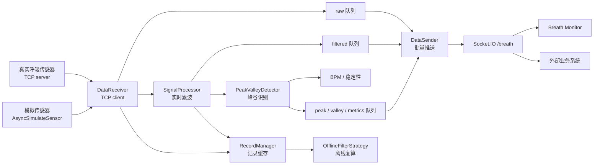
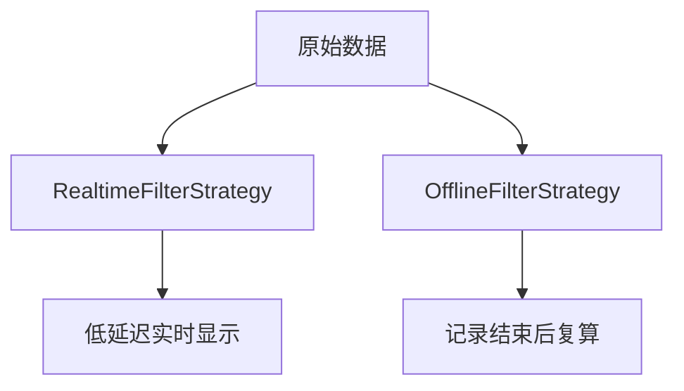

# RespiraScope 系统架构说明

本文面向希望理解项目实现方式的开发者，说明数据从传感器进入后，如何被接收、滤波、识别、记录并推送到前端。

## 总体流程



## 后端模块

| 模块 | 职责 |
| --- | --- |
| `ct_breath.core.config` | 读取外部 TOML 配置，支持启动参数及配置路径环境变量 |
| `ct_breath.app` | 创建 FastAPI 与 Socket.IO 应用 |
| `ct_breath.main` | 本地和 exe 启动入口，启动后端与静态 Web Console |
| `ct_breath.runtime.static_server` | 启动和注入静态前端运行配置，服务 Python 包内的原生 Console 静态源码 |
| `ct_breath.acquisition.receiver` | 从 TCP 传感器读取原始采样值 |
| `ct_breath.processing.processor` | 执行实时滑动窗口滤波 |
| `ct_breath.processing.strategies` | 区分实时滤波和离线滤波策略 |
| `ct_breath.processing.extrema` | 检测波峰、波谷，计算 BPM 和稳定性 |
| `ct_breath.recording.manager` | 保存 record 区间和前后辅助点 |
| `ct_breath.api.http` | 暴露启动接收、状态、记录、离线滤波等 HTTP 接口 |
| `ct_breath.api.websocket` | 维护 Socket.IO 命名空间和实时推送 |

## 实时与离线滤波

实时滤波使用因果滤波，目标是低延迟。它适合实时显示，但峰谷位置可能略有滞后。

离线滤波用于 Record End 后的复盘分析，可以使用更完整的上下文和双向滤波，目标是更平滑、更准确的结果。



## 前端入口

生产和开发环境都只启动一个 Web Console：

```text
http://localhost:5175
```

Console 壳层使用原生 HTML/CSS/JavaScript，资源存放于 `src/ct_breath/web/` 并随 Python 包分发，无需 Node/npm 构建。Console 中包含两个主要体验模式：

- 实时体验：面向用户显示呼吸数据、滤波结果、BPM、记录和扫描标记。
- 模拟实验：面向公网演示和调试模拟呼吸状态、波形预览和滤波效果。

基础使用说明和接口说明保留在仓库文档中，不再作为内置 Console 的主 tab。

## 配置边界

项目不依赖 `.env`。运行时配置可通过 `--config` 或 `RESPIRASCOPE_CONFIG` 指定；未指定时兼容查找已有配置，无配置时在对应平台的默认位置创建：

```text
Windows: %LOCALAPPDATA%/RespiraScope/config/breath.toml
macOS:   ~/Library/Application Support/RespiraScope/config/breath.toml
Linux:   /ct/breath-config/breath.toml
```

旧的 `D:/ct/breath-config/` 配置仍兼容读取。部署时可以只替换外部配置文件，无需修改程序包。

## 端口避让

启动时会先检查 `[backend].port` 是否可用。如果端口已被占用，程序会从后续端口中寻找一个空闲端口，并使用这个端口启动后端。

前端不会直接写死配置文件里的 backend port，而是读取 `/runtime-config.js` 中的实际运行端口。因此当后端从 `8000` 自动切换到 `8001` 时，实时体验和模拟实验也会同步连接到 `8001`。

## 局部分箱判断

离线质量判断不再因正常区间不足 300 点而整段排除。异常区间、与滤波器有关的边缘保护范围，以及异常对邻近曲线的影响仍被排除；不足 3 点的片段保留 `too_short` 标记。其余片段能否分箱，由以下峰谷和方向规则决定，不能将“未被排除”直接等同于“已有有效分箱”。

离线分箱先按质量排除区间、序号间断和无效数值切开数据。固定幅值分箱可保留有效峰谷旁方向明确的局部片段，不再要求另一端峰谷也已被检出；遇到显著反向变化时停止，不延续原方向，也不填充未经过的幅值箱。

时间分箱和周期内相对幅值分箱仍要求两个时间端点。如果同一有效区间中相邻的两个标记同为波峰或同为波谷，可以从实际滤波曲线找回中间漏检的相反转折。仅接受转折两侧都有明确方向的情况，不跨异常补点，不推测记录末端。

补充分段要求至少 3 个采样点、跨度至少 0.2 秒、净幅值变化不少于有效段 P95−P5 的 10%（最低 1 个信号单位），且净幅值变化至少占累计变化的 90%。这些是新增判断的工程阈值，不改变原有已检出完整半周期的划分。前后端分别通过 `binning/segments.py` 和 `binning-segments.js` 实现同一规则，并通过一致性测试校验。保存格式保持不变，不新增可信或预测状态，也不修改原始信号与公开峰谷列表。

## 离线曲线连续性

每段连续采集数据使用同一条离线滤波输出，异常区间不再被另一条参考曲线覆盖。短异常保留原有工作副本插值处理；长期异常仍保留在参考曲线中，其周边影响通过独立滤波对照扩大质量排除范围。真正的序号缺口仍分别滤波、断开绘制。

记录分析与模拟预览共享 `shared/filtered-series.js`：质量排除区间画虚线，其余画实线，交界使用同一个数据点。样式拆分不修改采样值，不改变分箱或导出数据；旧版原始占位值仍不当作滤波参考显示。已经保存的旧滤波结果需要重新计算才能消除原有数值接缝。

## 分箱数据明细与精简存储

记录卡片的“分箱数据”展示可筛选的状态表和存储 JSON。表格展示相对时间、采样序号、分类及方向／箱号；JSON 按方向、箱号和分类归集索引范围，不重复保存逐段对象。

完整记录仍为 JSON v6，`binningData` 升级为子协议 v4。以下示例含吸呼各五箱、一段排除和一段无法分箱：

```json
{
  "version": 4,
  "inhaleRising": true,
  "bins": {
    "inhale": [[[0,10]],[[10,20]],[[20,30]],[[30,40]],[[40,50]]],
    "exhale": [[[50,60]],[[60,70]],[[70,80]],[[80,90]],[[90,100]]]
  },
  "excluded": [[100,110]],
  "unassigned": [[110,120]]
}
```

- `inhaleRising` 明确吸气方向：`true` 为信号上升，`false` 为信号下降；它与同次记录的 `analysis.inhaleRising` 一致，单独导出时无需依赖外层配置判断方向。
- `bins` 仅包含有效数据，`bins.inhale` / `bins.exhale` 分别为吸气 / 呼气，每组依次为第 1 至 N 箱，N = `analysis.totalBins / 2`。空箱保留 `[]`。全空可以保存，但不代表有可用重建数据。
- 所有 `[start, end)` 使用完整 `filtered` 数组的整数下标，不是采样序号、时间戳或投影编号。连续边界映射到首个不早于边界的采样下标；无效点、缓冲点不删除或重排；缓冲不分箱。
- `excluded`、`unassigned` 分别为排除、无法分箱的索引区间数组，不保存具体原因。同类重叠或相邻区间合并，无该类数据时保存 `[]`。有效、排除、无法分箱的采样点互不重叠。
- 新标记描述记录范围内实际存在的滤波采样点。没有任何采样点的时间缺口不会伪造 `[i,i]` 区间，其原始序号范围仍保留在 `processingQuality` 中。`processingQuality` 还保留缓冲范围及滤波质量上下文，供重算使用；分箱 JSON 为消费端提供记录内的索引归属。
- 单独导出的 JSON 与 `binningData` 相同，仍需对应原记录的 `filtered` 数组；不重复携带波形、时间戳、逐段方向和状态对象。完整记录不再保存旧的 `respiratoryBins` 副本。

旧版记录可导入，并按波形、峰谷、质量与设置重新生成分箱数据。前后端以相同规则生成索引范围。文件使用紧凑 JSON，界面另行排版，只展示有效、排除、无法分箱三类和有效区间的方向／箱号。默认 HTTP 运行时响应保持旧结构；请求 `application/vnd.respirascope.record.v6+json` 返回紧凑记录。


### 离线峰谷人工修正

记录分析在离线滤波完成后提供“编辑峰谷”：在绘图区按横向位置自动添加波峰或波谷；点击与已有标记横向相距不超过 8 个 CSS 像素的位置即可删除，纵向无需对准标记，点击标记正上方或下方也有效；宽范围添加搜索找到已有标记时只提示，不删除也不重复添加；输入采样序号精确添加，位置不发生吸附，类型根据附近曲线判断。去掉单独的添加类型、移动和删除模式。Ctrl/Cmd+Z 撤销；Delete/Backspace 删除当前标记。快捷键仅在编辑区或图表获得焦点时生效，不干扰输入框的文字编辑。标记值取自已有滤波采样点，不修改波形，不在缺失数据中补造采样点，也不能在质量排除区间添加标记。

编辑期间即时预览当前分箱，暂停更改分析参数、保存记录和导出分箱。支持撤销最近 100 次操作、取消本次编辑、恢复自动标记。确认后，最终峰谷继续使用原 `peaks` / `valleys` 字段保存，`binningData` 按最终峰谷重新生成；原质量掩码和固定幅值上下界继续生效，不保证补齐每个周期所有分箱。

只有人工修改结果与自动结果不同时，记录文件附带 `extremaEdits: {version: 1, automatic: {peaks: [sequence, ...], valleys: [sequence, ...]}}`。该可选字段仅保存原始自动标记的序号，便于导入后恢复；不重复保存波形或幅值，也不添加到独立的分箱接口数据中。旧文件无需该字段。成功重新滤波或重判峰谷后删除人工修正信息并使用新的自动结果；失败则保留原结果。

自动寻找是编辑辅助：默认点击后在前后各 1 秒内寻找有双侧变化支持的局部峰谷，平顶/平底取平台中间的实际采样点；邻近多个候选时选择序号距离最近者。搜索根据局部采样序号间隔识别连续数据，兼容等间隔稀疏采样，不越过质量排除或明显数据缺口；双侧支持长度随可用数据缩短，不再使用固定幅差门槛。找不到候选则不自动添加，可输入转折附近序号精确标记；无法区分类型的平坦位置给出提示。窗口由采样率换算，属于交互范围，不改变滤波或自动峰谷检测算法。

编辑只增量更新峰谷、选中标记和分箱，不重建曲线，不重置缩放。工具栏始终占据固定空间，非编辑状态禁用操作；状态提示、操作反馈和计数区域预留空间，避免编辑中信息变化引起图表位移。

记录分析工作区：桌面端左侧为分箱与滤波参数，右侧为模式工具栏和波形；窄屏先显示波形，再显示参数。记录文件操作集中在顶部。查看模式显示结果说明和“进入编辑”，不显示编辑输入和退出按钮；编辑模式显示状态徽标、浅色边框及参数锁定说明，提供“应用并退出”和“取消并退出”。前者应用当前标记并返回查看，后者恢复进入编辑前的标记。应用不等于保存文件，界面提示通过“保存记录”导出。两个模式的工具栏使用相同空间，切换不改变图表位置与缩放。
